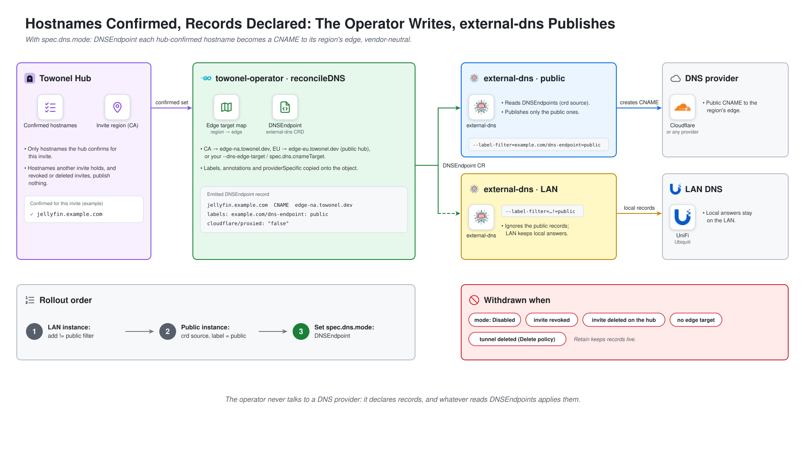

# towonel-operator

A Kubernetes operator that automates [Towonel](https://towonel.dev) self-hosted tunnels —
provisioning tunnels, deploying agents, and connecting them, declaratively. It does not run
tunnels itself (the Towonel hub, edges, and agent do), and it never talks to a DNS provider.

> [!WARNING]
> **Agentically generated.** This codebase was produced through agentic,
> spec-driven development: each feature began as a written design and
> implementation spec, then a coding agent executed the plan under human
> review. Tests, code review, and CI gates apply as they would for any
> project, but the authorship pattern is not a single human contributor —
> keep that in mind when evaluating fit for your environment.

## Features

Towonel exposes services behind NAT/CGNAT without inbound ports. This operator drives that from
Kubernetes:

- **`TowonelTunnel`** — the control plane. Reconciles a Towonel invite (token, authorized
  hostnames, TCP/UDP port reservations) against the Towonel API and owns the token Secret.
- **`TowonelAgent`** — a placement-specific workload that references a tunnel and renders the
  agent Deployment plus its `hostname → origin` routing. Multiple agents can share one tunnel for
  failover. See [`docs/architecture.md`](docs/architecture.md) for the why behind the
  two-resource split.
- **Annotation source layer** — annotate a `Service`, `Gateway`, or `HTTPRoute` and let the
  operator materialize the agents for you (the dogfooding path).
- **Gateway auto-routes** — set `towonel.io/auto-routes: "true"` on a Gateway to tunnel its
  same-namespace HTTPRoutes without annotating each one; see
  [Gateway auto-routes](docs/source-layer.md#gateway-auto-routes-towonelioauto-routes).
- **Cross-namespace auto-routes** *(optional)* — a Gateway can extend auto-routes to other
  namespaces with a `towonel.io/auto-routes-namespaces` allowlist (off by default). Note the
  [security implications](docs/source-layer.md#cross-namespace-auto-routes-towonelioauto-routes-namespaces)
  of public cross-namespace exposure.
- **Direct-path connectivity** *(optional)* — advertise a reachable address so peers connect over
  a direct iroh path instead of relaying; see [`docs/connectivity.md`](docs/connectivity.md).
- **DNS handoff** *(optional)* — with `spec.dns.mode: DNSEndpoint` the operator emits an
  external-dns `DNSEndpoint` that CNAMEs each hub-confirmed hostname to its region's edge; see
  [DNS handoff](#dns-handoff-optional).
- **Region endpoints status** — `status.regionEndpoints` reports the live edge IPs per region,
  with a `RegionEndpointsAvailable` condition. Always on, informational only.
- **Agent metrics and dashboard** *(optional)* — a cluster-wide Prometheus `PodMonitor` and the
  upstream Grafana dashboard, both off by default.

## Quickstart

**Prerequisites:** a Towonel account + a personal API key, and a Kubernetes
cluster. (Full prerequisites and chart values: [`docs/installation.md`](docs/installation.md).)

**1. Install the operator** (Helm, OCI chart on GHCR):

```sh
kubectl create namespace towonel-system
kubectl create secret generic towonel-api -n towonel-system --from-literal=token='twk_xxx'

helm install towonel-operator \
  oci://ghcr.io/jacaudi/charts/towonel-operator --version <version> \
  --namespace towonel-system \
  --set credentials.existingSecret=towonel-api
```

Replace `<version>` with the chart version you want — use the [latest release](https://github.com/jacaudi/towonel-operator/releases).

**2. Create a tunnel** (the control plane — provisions the Towonel invite + token):

```yaml
apiVersion: towonel.io/v1alpha1
kind: TowonelTunnel
metadata:
  name: app
  namespace: towonel-system
spec:
  region: EU
  apiKeySecretRef:
    name: towonel-api
    key: token
  deletionPolicy: Retain
```

**3. Expose a service** — either annotate it:

```yaml
apiVersion: v1
kind: Service
metadata:
  name: grafana
  namespace: monitoring
  annotations:
    towonel.io/tunnel: enable
    towonel.io/tunnel-ref: towonel-system/app
    towonel.io/hostname: grafana.example.com
spec:
  selector:
    app.kubernetes.io/name: grafana
  ports:
    - name: http
      port: 3000
      targetPort: 3000
```

…or author a `TowonelAgent` directly for full control (HTTPS + raw TCP/UDP, failover,
[direct-path connectivity](docs/connectivity.md)) — see [`docs/examples/`](docs/examples/).

**4. Point DNS** *(optional)*. Set `spec.dns.mode: DNSEndpoint` on the tunnel and run external-dns with
`--source=crd`: the operator publishes a `CNAME` per confirmed hostname to Towonel's regional
edge. Or create the records yourself from `status.dnsRecords`. See [`docs/dns.md`](docs/dns.md).

```sh
kubectl get towoneltunnel app -n towonel-system -o yaml   # inspect status
```

## How it works


*Sources in your cluster become Towonel tunnels and agents; the hub authorizes hostnames and the
edge carries traffic home.*

- **Sources** — annotated `Service`, `Gateway`, and `HTTPRoute` objects, or `TowonelAgent` and
  `TowonelTunnel` resources you write yourself. The operator watches them all.
- **towonel-operator** — turns each source into a `TowonelAgent` (hostname → origin) and keeps the
  `TowonelTunnel` in step with the hub.
- **Towonel hub** — authorizes each hostname for one invite, reserves TCP/UDP ports, and reports
  live edges per region.
- **Agents** — Deployments the operator renders. They dial out over QUIC, so nothing listens on
  your network.
- **Edge** — routes by SNI to the tunnel that owns the hostname.

See [`docs/architecture.md`](docs/architecture.md) for the data and control flow.

## DNS handoff *(optional)*



*The operator declares the records; whatever reads `DNSEndpoint` objects applies them.*

Off by default. Set `spec.dns.mode: DNSEndpoint` on a tunnel and the operator emits one
external-dns `DNSEndpoint` per tunnel, with a `CNAME` for every hostname the hub has confirmed.
The target is the invite region's edge (`CA` → `edge-na.towonel.dev`, `EU` → `edge-eu.towonel.dev`
on the public hub), or one you set with `--dns-edge-target` / chart `dns.edgeTargets`. Records are
withdrawn when the mode is `Disabled`, the invite is revoked or deleted, no edge target remains, or
the tunnel is deleted under `deletionPolicy: Delete`. To keep a hostname out of DNS (a zone apex
your provider can't CNAME, say), annotate its source `towonel.io/dns-record: "false"`; the hub
still authorizes it ([opt-out](docs/dns.md#what-gets-published)). See [`docs/dns.md`](docs/dns.md)
for the consumer setup and the mandatory rollout order.

## Agent environment variables

To pass settings the operator does not model to the Towonel agent — log verbosity, for example — set `agentEnv` in the chart. The variables are added to **every** operator-managed agent pod, hand-authored `TowonelAgent`s and auto-created default agents alike:

```yaml
agentEnv:
  RUST_LOG: info,iroh::socket::transports=trace
```

- **Operator-wide, plain values.** There is no per-agent override and no `valueFrom`; each entry is a `name: value` pair.
- **Changing it rolls every agent.** All agent Deployments restart with the new environment.
- **Operator-managed names win.** A name the operator sets itself (invite token, rendered services, relay URL, connectivity, health address) cannot be overridden: the entry is ignored and each affected agent gets an `EnvIgnored` Warning event.
- **Bad entries stop the operator.** An invalid or duplicate name fails the manager at startup rather than being dropped silently.

## Agent metrics (Prometheus)

Operator-managed Towonel **agent** pods serve Prometheus metrics at `/metrics` on port `9090`. Scraping is **opt-in and off by default**. Enable a single cluster-wide `PodMonitor` (selects all agent pods in every namespace) via the chart:

```yaml
observability:
  metrics:
    agentPodMonitor:
      enabled: true
      # Most Prometheus installs only discover PodMonitors carrying a specific label:
      additionalLabels:
        release: kube-prometheus-stack
```

- **Requires the Prometheus Operator `PodMonitor` CRD** (`monitoring.coreos.com/v1`). With the toggle on, `helm install`/`upgrade` fails on clusters without it.
- **`additionalLabels` is usually required.** kube-prometheus-stack only selects PodMonitors carrying its release label; without it the PodMonitor is silently ignored — enabled but never scraped.
- **Namespace-scoped Prometheus.** The PodMonitor selects pods in all namespaces (`namespaceSelector.any: true`), but a Prometheus restricted by `podMonitorNamespaceSelector` must be allowed to read it and the agent namespaces.
- **Existing agents.** The `metrics` port reaches already-running agents only on their next config change; to cover them immediately, run `kubectl rollout restart deploy -l app.kubernetes.io/name=towonel-agent`.
- **Job label.** Agent series carry `job="towonel-agent"` (the PodMonitor sets `jobLabel: app.kubernetes.io/name`). Before the dashboard was added they carried `job="<release-namespace>/towonel-operator-agents"`; update any alert or query that matched the old value.

## Agent dashboard (Grafana)

The chart bundles the upstream [Towonel agent dashboard](https://codeberg.org/towonel/towonel/src/branch/main/deploy/grafana) (streams, errors, throughput, edge sessions, process stats), unmodified. It is **opt-in and off by default**, and charts the series the agent `PodMonitor` above scrapes, so enable both:

```yaml
observability:
  metrics:
    agentPodMonitor:
      enabled: true
  dashboards:
    enabled: true
```

- **Grafana sidecar (default).** Renders a ConfigMap labelled `grafana_dashboard: "1"`, which the kube-prometheus-stack / Grafana chart sidecar loads automatically. If the sidecar only watches Grafana's own namespace, set `observability.dashboards.namespace` to it.
- **grafana-operator.** Set `observability.dashboards.grafanaOperator.enabled: true` and `grafanaOperator.matchLabels` to your `Grafana` instance's labels. The chart then renders a `GrafanaDashboard` CR (`grafana.integreatly.org/v1beta1`) referencing the ConfigMap and drops the sidecar label. `helm install`/`upgrade` fails without that CRD, or if `matchLabels` is empty.
- **Scraping agents yourself.** Without the bundled `PodMonitor`, give the agent series `job="towonel-agent"`, or the process panels stay empty.

## Documentation

Full docs live in [`docs/`](docs/):

| Doc | Default | Covers |
|---|---|---|
| [Installation](docs/installation.md) | — | Helm (OCI) install, chart values, manager flags, prerequisites |
| [Architecture](docs/architecture.md) | — | The two-resource model, why routing is agent-side, failover, the source layer |
| [`TowonelTunnel`](docs/crd-towoneltunnel.md) | — | Control-plane CRD reference: spec, status, conditions, lifecycle |
| [`TowonelAgent`](docs/crd-towonelagent.md) | — | Workload and routing CRD reference |
| [Source layer](docs/source-layer.md) | — | Expose a `Service`, `Gateway`, or `HTTPRoute` by annotation |
| [Direct-path connectivity](docs/connectivity.md) | off | Optional iroh NAT-traversal (`spec.connectivity`) |
| [DNS](docs/dns.md) | off | Public DNS handoff via external-dns `DNSEndpoint` |
| [Examples](docs/examples/) | — | Runnable sample manifests |

## Acknowledgements

- **[Bernd Schorgers (bjw-s)](https://github.com/bjw-s)** — this operator's Helm chart is built on
  the [bjw-s `app-template`](https://github.com/bjw-s-labs/helm-charts) common library, which does the
  heavy lifting of rendering the controller Deployment, RBAC, service account, and service. Thank you
  for an excellent, reusable chart!
- **[Erwan Leboucher (eleboucher)](https://github.com/eleboucher)** — the creator of
  [Towonel](https://towonel.dev) itself ([codeberg](https://codeberg.org/towonel/towonel) ·
  [github](https://github.com/eleboucher/towonel)). This operator only automates the client side;
  Towonel — the hub, edges, and agent — is his work. Thank you for creating a self-hosted
  Cloudflare Tunnel replacement!
- **[external-dns](https://github.com/kubernetes-sigs/external-dns)** — applies the `DNSEndpoint`
  objects this operator emits to any DNS provider, which is why the operator never needs provider
  credentials.

## License

[MIT](LICENSE) © 2026 jacaudi
